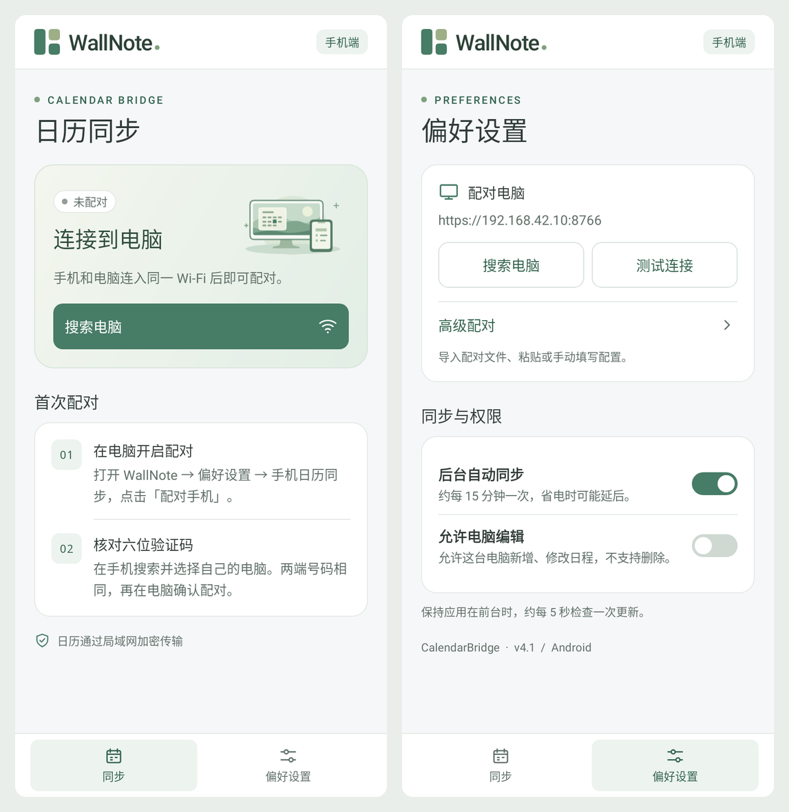

# CalendarBridge

通用 Android 日历同步助手，与 [WallNote 桌面端](https://github.com/zihayi/WallNote)配合使用。

[下载 Android 安装包（APK）](https://github.com/zihayi/CalendarBridge/releases/latest/download/CalendarBridge.apk) · [查看版本说明与 SHA-256 校验文件](https://github.com/zihayi/CalendarBridge/releases/latest)

使用 Android 标准日历接口，支持 Android 8.0 及以上。不依赖 OPPO 互联、ADB 或投屏；安装后可导入自己的电脑配对配置。



## 功能

- 手机日历同步到 WallNote，显示在日历和时间表中。
- 在 WallNote 中把本地日程发送到手机，或提交普通手机日程的修改。
- 同一 Wi-Fi 自动发现电脑，首次核对验证码配对，以后自动重连。
- WallNote 内置接收服务，随应用启动和退出，不需要单独运行 Python。
- HTTPS 加密连接，固定证书指纹校验；自动发现不会跳过身份验证。
- 操作队列持久化、重复请求去重、修改冲突检查。
- 手机前台约每 5 秒轮询；可选后台同步约每 15 分钟，实际时间受系统省电策略影响。

手机必须在「偏好设置」明确开启「允许电脑编辑」。收到手机回执和最新快照前，WallNote 会显示“待确认”，不会提前显示“已同步”。

## 配对和运行

### 推荐：WallNote 自动连接

建议搭配 [WallNote 最新 Windows 安装版](https://github.com/zihayi/WallNote/releases/latest) 使用。安装 **CalendarBridge Android v4.1** 后：

1. 手机和电脑连接同一 Wi-Fi，打开 WallNote。
2. 电脑「偏好设置 → 手机日历同步 → 配对手机」。
3. 手机在「同步」页点击「搜索电脑」，选择自己的电脑。
4. 核对手机和电脑上的六位验证码，在电脑点击「验证码一致，允许配对」。配对窗口持续 2 分钟。
5. 手机授予日历读取权限后会立即同步，并开启约每 15 分钟的后台同步；前台会更频繁地同步。

首次配对后，不需要 USB、不需要传配置文件。电脑地址或服务端口改变时，手机会自动发现并验证原证书；不能自动信任另一台电脑。日历读写仍通过局域网 HTTPS 完成。

配对后，「同步」页可以立即同步、查看最近上传时间（北京时间）和同步结果。「已配对」表示保存了电脑身份，不代表电脑当前在线；需要检查时，点击「偏好设置 → 测试连接」。

需要从电脑新增或修改日程时，在手机「偏好设置 → 允许电脑编辑」开启编辑权限，并在 WallNote 选择写入日历。自动配对不会自动授权写入。

WallNote 需要保持运行，关闭管理窗口即可留在托盘。Android 后台任务受省电策略影响，不保证锁屏后实时同步。若无法发现电脑，请检查双方的本地网络权限，以及 Wi-Fi 是否开启访客隔离/客户端隔离。

内置服务数据位于 WallNote 数据目录下的 `wifi-receiver/`；旧的独立服务和数据保留。

### 高级：独立接收服务

以下为兼容旧版和开发时的手动运行方式。

#### 1. 电脑初始化接收服务

需要 Python 3.10+；初始化和构建 APK 需要 `cryptography`。

```powershell
python -m pip install -r requirements-dev.txt
python setup_receiver.py
python server.py
```

也可以双击 `Setup.cmd`，然后双击 `Start-Receiver.cmd`。

默认端口是 **8766**，与旧工程的 8765 分开。自动检测到的地址不正确时，指定手机能访问的局域网 IPv4 地址：

```powershell
python setup_receiver.py --host 192.168.1.10 --port 8766
```

初始化会生成：

| 文件 | 用途 |
| --- | --- |
| `state/pairing.json` | 导入手机应用 |
| `state/wallnote-connection.json` | 导入 WallNote |

配对文件含访问密钥，请仅在自己的设备之间传递。重新运行初始化会保留已有密钥和证书。

#### 2. 手机安装和配对

安装 `dist/CalendarBridge.apk`，打开「日历同步助手」：

1. 手机打开「偏好设置 → 高级配对 → 导入文件」，选择电脑生成的 `pairing.json`；也可以粘贴文件中的 JSON 或手动填写。核对配置后点击「保存配对」。
2. 点击「测试连接」，然后回到「同步」页，点击「授权并同步」并授予日历读取权限。已有权限时按钮显示「立即同步」。
3. 需要电脑修改日程时，到「偏好设置」开启「允许电脑编辑」并授予写入权限。

手机与电脑需处于可互通的局域网，电脑接收服务需保持运行。更换配对电脑后，编辑开关会关闭，需要重新授权。

#### 3. WallNote 连接

使用 **WallNote v0.5.0 或更新版本**：

1. 偏好设置 → 手机日历同步 → 高级：连接独立接收服务 → 连接接收服务。
2. 选择 `state/wallnote-connection.json`。
3. 选择本地日程要写入的手机日历。
4. 打开本地日程，点击「发送到手机」。手机来源的普通日程可点击「提交手机修改」。

手机单独修改已关联的日程后，WallNote 会在本地内容未改动时更新它；两端同时修改时显示冲突，不自动覆盖。

## 当前范围

- 只同步系统 Calendar Provider 中的日历，不读取其他应用的私有数据。
- WallNote 展示近 30 天至未来 180 天的日程实例。重复、全天、跨天或特殊时间日程只读，请在手机修改。
- 支持新增和修改；不提供删除手机日程。
- 一套接收服务数据绑定一台手机。其他手机使用独立配置和数据目录。
- 不确定的写入不会自动重放；请先在手机核对。
- 不支持 iOS、原生 HarmonyOS NEXT 或不提供标准日历接口的设备。

## 构建 APK

需要 JDK 和 Android SDK 35，可使用标准 SDK，也兼容原工程的 `android-15` 构建工具布局。

```powershell
$env:JAVA_HOME = '你的 JDK 路径'
$env:CALENDAR_SDK_ROOT = '你的 Android SDK 路径'
python dev/build_android.py --init-signing-key
```

已有签名时直接运行 `python dev/build_android.py`。本机 `.local-build.json` 沿用原工程签名，并验证与 v2 APK 的签名一致；原工程不会被覆盖。

包名保持 `local.calendar.readonly`，当前 `versionCode=5`、`versionName=4.1`。已有同签名的 v2/v3/v4 安装可覆盖升级，保留原配对、授权和幂等日志；更换配对电脑需重新确认编辑权限。新安装默认未配对，APK 不包含电脑地址或访问密钥。

输出：`dist/CalendarBridge.apk`、`dist/SHA256-latest.txt`。

## 构建内置 Windows 接收服务

在构建用 Python 环境安装 `requirements-build.txt`，运行：

```powershell
python dev/build_receiver.py --output ../WallNote/dist-native
```

生成 `CalendarBridge.Receiver.exe`，无需目标电脑安装 Python。WallNote 打包脚本会执行此步骤，可用 `CALENDAR_BUILD_PYTHON` 指定构建环境，用 `CALENDAR_BRIDGE_ROOT` 指定本工程目录。打包仅包含源码和依赖，不包含任何本机配置、签名或日历数据。

协议说明见 [docs/wifi-pairing.md](docs/wifi-pairing.md)。

## 数据和测试

`state/` 保存本机证书和配对配置，`data/` 保存快照与 SQLite 操作队列。它们和签名配置均已加入 `.gitignore`。

```powershell
python -m unittest discover -s tests -v
```

测试使用临时目录和模拟手机数据。WallNote 工程中的 `node scripts/smoke-phone.mjs` 验证两个工程之间的 HTTPS 和操作队列。编译和模拟测试不代表实机新增、修改已成功；实际手机操作由用户确认。
